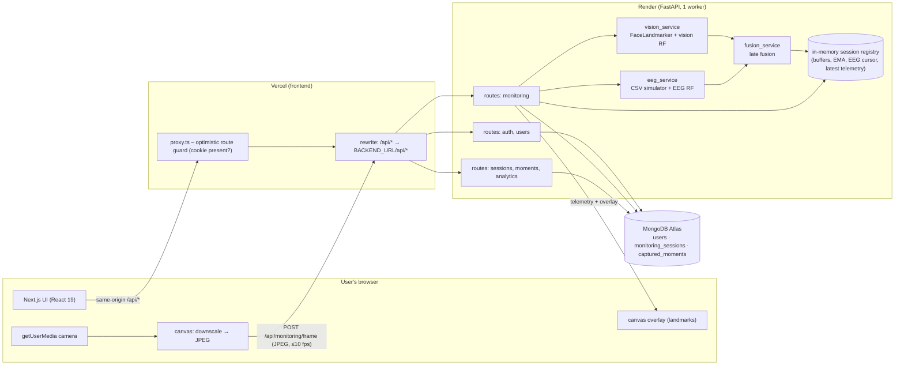
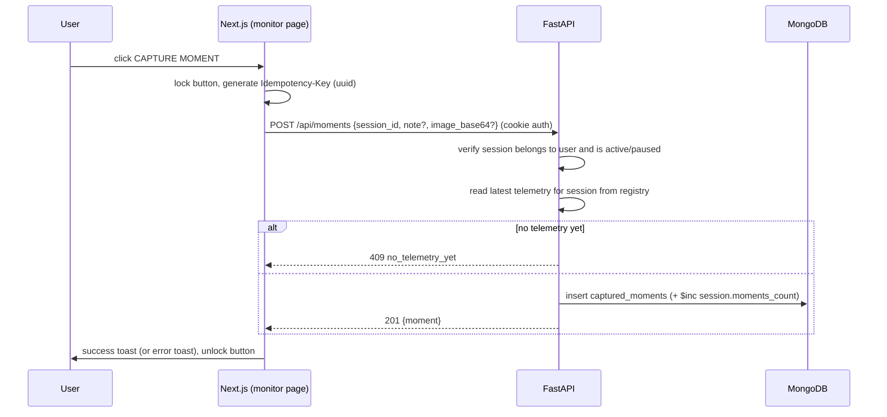

# PROJECT_CONTEXT.md

**Project:** AI-Driven Ocular & Cognitive Focus Monitoring Platform
**Owner of this document:** Account 1 (Architect / Integration Manager)
**Audience:** Account 2 (Frontend), Account 3 (Backend + ML), and anyone resuming the project.
**Status legend used across all docs:** ✅ verified from the uploaded files · 🟡 decided by Account 1 (design decision) · ❓ requires verification / owner decision

---

## 1. Project overview

A web application that estimates a **focus-related state** from two modalities and fuses them:

1. **Vision modality** – webcam frames → MediaPipe FaceLandmarker (478 landmarks) → eye/gaze/head-pose features → Random Forest.
2. **EEG modality** – spectral band-power features (theta/alpha/beta) → Random Forest. **In this project EEG is simulated** by replaying `mock_eeg_stream.csv`; no EEG hardware is connected.
3. **Late fusion** – each modality is thresholded at 0.5; the 2×2 outcome gives a fused label and a "modality mismatch" alert.

On top of that existing engine the product adds: landing page, registration/login, per-user dashboard, live monitoring with a **Capture Moment** button, "My Moments", session history, analytics, and profile/privacy settings — all backed by MongoDB Atlas.

> Responsible-interpretation rule (applies everywhere in UI and copy): outputs are *experimental model estimates of a focus-related state*, **not** medical diagnosis or a measurement of someone's mental state. EEG values are *simulated replay data*, never the user's own brain activity.

## 2. What exists today (✅ verified by inspecting the ZIP)

| File | What it is |
|---|---|
| `backend.py` (387 lines) | Single-file FastAPI app. Loads both models + CSV + `face_landmarker.task`, exposes `GET /`, `GET /video_feed` (MJPEG from the **server's** webcam via `cv2.VideoCapture(0)`), `GET /telemetry`, `POST /analyze_image`. All state is global/module-level. |
| `train_multi_subject.py` (217 lines) | Training script for both Random Forests from an EEG/video BIDS-style dataset (not included). Also writes `mock_eeg_stream.csv`. |
| `vision_model.joblib` | `RandomForestClassifier`, 100 trees, 10 features, classes [0,1], pickled with scikit-learn **1.9.1**. |
| `eeg_model.joblib` | `RandomForestClassifier`, 100 trees, 5 features, classes [0,1], scikit-learn **1.9.1**. |
| `mock_eeg_stream.csv` | 1000 rows × 7 columns (`onset, theta_power, alpha_power, beta_power, alpha_theta_ratio, alpha_beta_ratio, target_state`). Three concatenated subject blocks (374 / 508 / 118 rows). |
| `face_landmarker.task` | MediaPipe FaceLandmarker model bundle (3.7 MB). |
| `frontend/` | Next.js **16.4.3**, React **19.3.0**, TypeScript 5, Tailwind CSS 4 (via `@tailwindcss/turbopack`). One page (`app/page.tsx`, 345 lines): a dark slate dashboard polling `http://127.0.0.1:8000/telemetry` every 250 ms, an `` pointed at `http://127.0.0.1:8000/video_feed`, and an upload widget for `/analyze_image`. |

Verified by Account 1: `npm ci` succeeds (366 packages); both `.joblib` models load and predict under scikit-learn 1.9.1.
Not verified: `next build` (fails in Account 1's sandbox only because Google Fonts cannot be fetched there — not a code error; **build is therefore unverified**); `backend.py` was read but not executed.

### What works / what is incomplete / what is broken in the existing code

| Area | Assessment |
|---|---|
| Model loading, feature order via `feature_names_in_`, fusion function, annotated-image endpoint | **Works (reusable).** Keep the logic. |
| Telemetry JSON shape (`vision_score`, `eeg_score`, `fused_state`, `discrepancy_alert`, `metrics{…}`) | **Reusable.** Preserved in the new contract (snake_case kept). |
| Server webcam (`cv2.VideoCapture(0)`) + MJPEG `/video_feed` | **Cannot work when deployed** (server has no camera). Replaced by browser `getUserMedia` + frame upload. |
| Global state (`telemetry_state`, rolling buffers, EMA, `was_eye_closed`, EEG index) | **Single-user only.** Two users would corrupt each other. Must become per-session objects. |
| Telemetry only advances while `/video_feed` is being consumed | Design flaw; replaced by frame-driven processing. |
| Initial `vision_score 0.85` / `eeg_score 0.75` / frontend fallback 50 % | **Fabricated placeholders.** Must be `null` until a real inference exists. |
| `allow_origins=["*"]` with `allow_credentials=True` | Invalid/insecure; replaced by explicit origin list. |
| `face_landmarker.task` downloaded at runtime if missing | Remove; ship the file. Relative paths (`"vision_model.joblib"`) depend on CWD; use paths relative to the module. |
| `face_landmarker.detect()` inside `async def` | Blocks the event loop; run in a threadpool. |
| Hard-coded `127.0.0.1:8000` in frontend | Removed; same-origin `/api/*`. |
| No auth, DB, history, tests, `requirements.txt` | Missing; to be built. |
| ML honesty issues (EEG "confidence" is a hand-tuned rule, label circularity, domain mismatch) | **Documented in `ML_INTEGRATION.md`. Must be surfaced, not hidden.** |

## 3. Final technology stack

| Layer | Choice | Note |
|---|---|---|
| Frontend | Next.js 16.4.3, React 19.3.0, TypeScript, Tailwind CSS 4 | ✅ kept as-is (compatible: `npm ci` OK). Add: `lucide-react`, `recharts`, `framer-motion`. ❓ confirm React-19 compatible versions at install time. |
| Backend | Python FastAPI, uvicorn, **1 worker** | 🟡 In-memory per-session state requires a single process (see §5). |
| ML | scikit-learn **pinned to 1.9.1**, joblib, numpy, pandas, MediaPipe (`mediapipe` 0.10.x), `opencv-python-headless` | 🟡 Pin sklearn to match the pickles. Use *headless* OpenCV on the server. |
| DB | MongoDB Atlas via **PyMongo Async API (`AsyncMongoClient`)** | 🟡 Chosen over Motor (Motor is deprecated in favour of PyMongo's async API). ❓ Account 3 confirms the installed PyMongo version exposes `AsyncMongoClient`. |
| Auth | JWT (HS256) in **HttpOnly cookie**, Argon2id hashing (`argon2-cffi`) | 🟡 Argon2 chosen (no 72-byte limit like bcrypt). |
| Deploy | Vercel (frontend), Render (backend), Atlas (DB) | See §6. |

## 4. Key architecture decisions (binding on all accounts)

| # | Decision | Why |
|---|---|---|
| D1 | **Browser captures the camera** (`getUserMedia`), downsizes to a JPEG (≈320 px wide, quality ≈0.7) and `POST`s it to `/api/monitoring/frame` at **≤ 10 fps**. Server returns telemetry + a normalized landmark overlay in the same response. | A deployed server cannot see the user's camera. Returning overlay *coordinates* (not an annotated JPEG) keeps bandwidth low; the browser draws them on a `<canvas>`. |
| D2 | **Same-origin API via Next.js rewrite**: browser always calls relative `/api/...`; `next.config.ts` rewrites `/api/:path*` → `${BACKEND_URL}/api/:path*`. | Vercel and Render are different *sites*; a backend-set cookie would be third-party and blocked by Safari/Chrome. With the rewrite the cookie is first-party on the Vercel domain. No `NEXT_PUBLIC_API_URL`, no CORS dependency, no localhost in prod. |
| D3 | **JSON naming = `snake_case` everywhere** (API *and* MongoDB fields). | Existing telemetry already uses snake_case; one convention end-to-end avoids mapping bugs. *Deviates from the camelCase examples in the master prompt — flagged in open questions.* |
| D4 | **Server is the source of truth for Capture Moment.** Client sends only `session_id` (+ optional `note`, optional image). The server snapshots *its own* latest telemetry for that session. | Prevents client-fabricated "model outputs" being stored; guarantees stored values are genuine inference results. |
| D5 | **EEG is simulated and labelled.** Every telemetry object and every stored moment carries `eeg_source: "simulated_csv"`. UI must show a persistent "Simulated EEG" badge. | Honesty requirement of the master prompt. |
| D6 | **One live session per user** (`active` or `paused`), enforced by a partial unique index. | Simplifies state and aggregation. |
| D7 | Per-session processing state (`VisionFeatureExtractor`, `EEGSimulator`) lives in a server-side in-memory registry keyed by `session_id`, with idle expiry; durable results are written to MongoDB. | Replaces module globals. |
| D8 | Error envelope `{"error":{"code","message","details"}}` for all non-2xx. | Existing `{"error": "..."}` string is replaced; frontend reads `error.message`. |
| D9 | Pagination everywhere with `page`, `page_size`. | Master prompt requirement. |
| D10 | Timestamps: ISO-8601 UTC with `Z` suffix in API; BSON `Date` in MongoDB. IDs: 24-char hex ObjectId strings, exposed as `id`. | Consistency. |

## 5. System architecture

### Capture Moment sequence

### Data flow summary

- **Webcam →** browser → `/api/monitoring/frame` → MediaPipe → features → vision RF → vision score.
- **EEG →** server-side simulator advances one CSV row per second per session → EEG RF → calibrated EEG score (heuristic, see ML doc).
- **Fusion →** thresholds at 0.5 → `fused_state`, `fused_code`, `discrepancy_alert`.
- **Persistence →** only on session start/stop/heartbeat and on Capture Moment. Per-frame telemetry is **not** stored (aggregates are computed in memory and written to the session).

## 6. Deployment shape

- **Vercel**: Root Directory = `frontend/`. Env: `BACKEND_URL=https://<service>.onrender.com`.
- **Render**: Web Service, root `backend/`, build `pip install -r requirements.txt`, start `uvicorn app.main:app --host 0.0.0.0 --port $PORT --workers 1`, health check `/api/health`.
- **Atlas**: connection string in `MONGODB_URI`; Render egress IP must be allow-listed in Atlas Network Access.

Known deployment limitations (❓ to verify during integration):
1. Render free-tier instances have limited RAM and sleep when idle (cold start). MediaPipe + OpenCV + scikit-learn + pandas memory footprint is **unmeasured**.
2. In-memory session state ⇒ **exactly one worker, one instance**. A restart ends live sessions (they become `abandoned`).
3. Per-frame round-trip latency (browser → Vercel → Render) is unmeasured; the 10 fps ceiling is a target, not a promise.
4. Request-size limits on Vercel rewrites are unverified; frames are kept ≤ 500 KB and uploaded images ≤ 4 MB to stay safe.
5. EEG hardware cannot connect to a hosted backend; real EEG would need a separate bridge (out of scope).

## 7. Folder structure

See `PROJECT_STRUCTURE.md` (authoritative, with file ownership).

## 8. Development conventions

- **Naming:** API/DB fields `snake_case`; TypeScript types mirror API exactly (no camelCase mapping layer); React components `PascalCase`; Python modules `snake_case`.
- **No fake data:** no seeded demo rows, no placeholder metrics, no random predictions. Missing = `null` and an explicit empty/"waiting" state.
- **No localhost** in any file except `.env.example` comments and local-dev defaults clearly labelled.
- **Secrets:** only via environment variables; never committed.
- **Ownership:** each file has exactly one owning account (`PROJECT_STRUCTURE.md`). Do not edit files you do not own; request changes via the contract documents.
- **Contract changes:** only Account 1 edits `API_DOCUMENTATION.md` / `DATABASE_SCHEMA.md`. If you find a contract problem, report it (with the endpoint and a proposed fix) instead of silently diverging.
- **Wording:** "estimated focus-related state", "model classification", "vision-based indicators", "EEG-based indicators (simulated)". Never "diagnosis", "brain reading", "mental state detected".
- **Verification honesty:** do not report something as working unless it was run. Report what was and was not tested.

## 9. Integration requirements (what Account 1 will check)

1. Every endpoint in `API_DOCUMENTATION.md` exists on the backend and is called with identical paths/fields from the frontend.
2. Cookie auth works through the Vercel rewrite (Set-Cookie passes through; `Secure`, `HttpOnly`, `SameSite=Lax`).
3. User isolation: user B receives 404 for user A's ids on every resource.
4. Capture Moment persists in Atlas and survives logout/login.
5. Legacy-equivalence: refactored feature/fusion functions produce the same outputs as `backend.py` for identical inputs (golden test).
6. No fabricated defaults; `eeg_source` label visible.

## 10. Open questions

Listed in `PROJECT_PROGRESS.md` §9 and in the chat summary.
